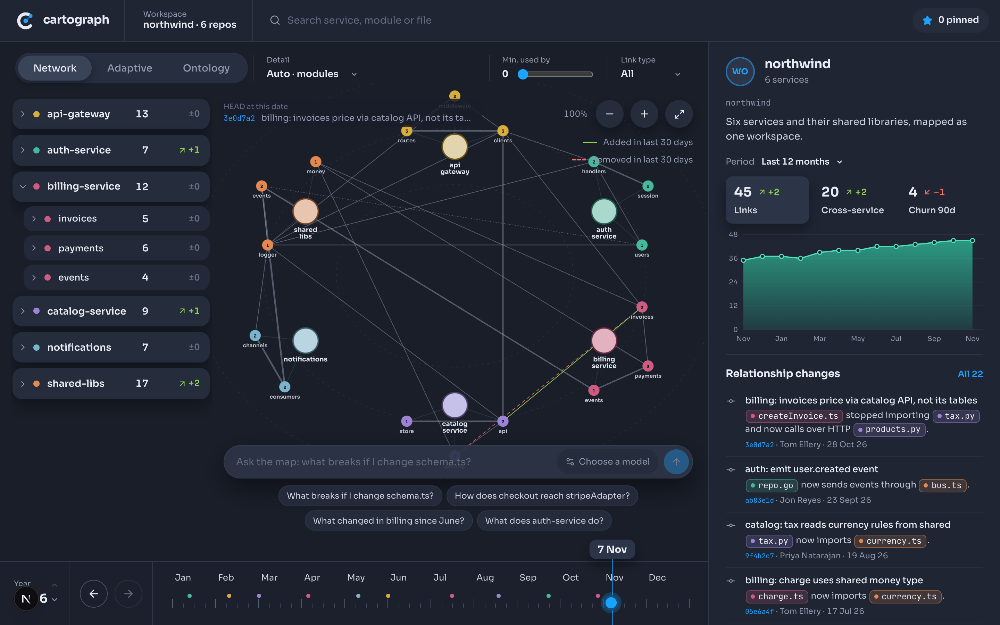
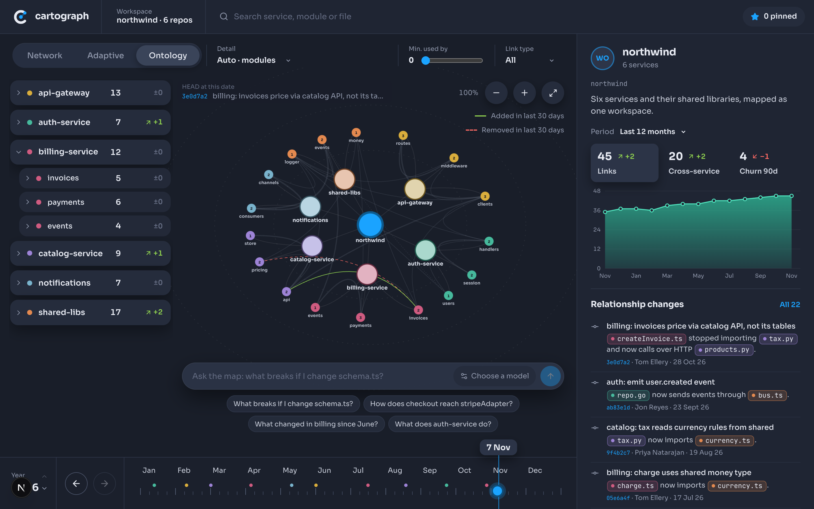
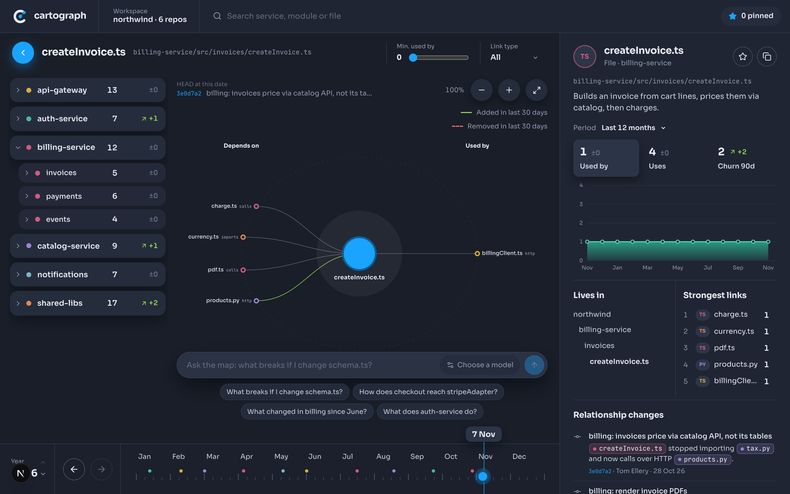
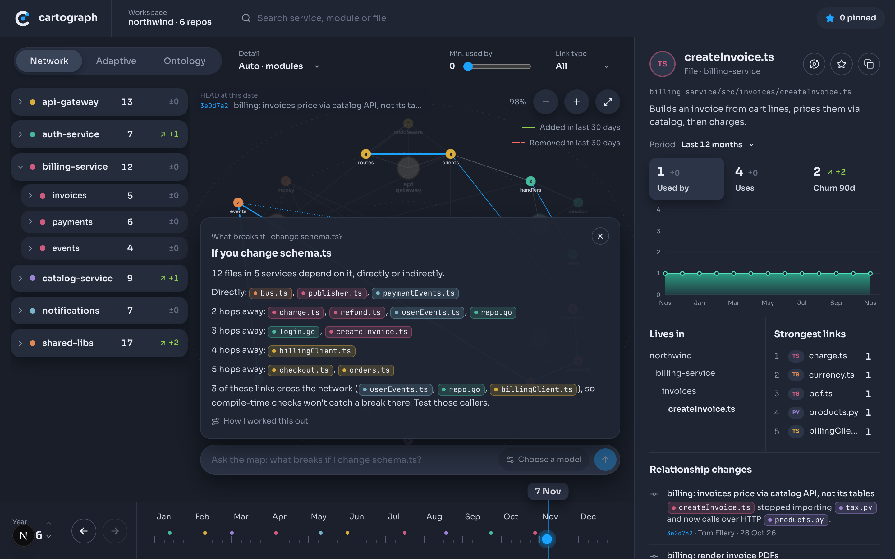
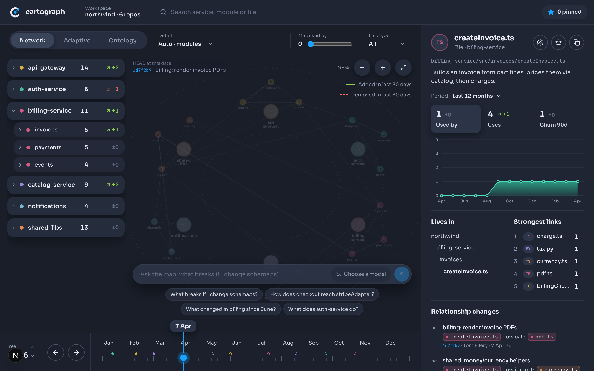

<p align="center"></p>

<h1 align="center">Cartograph</h1>

<p align="center">A codebase map that reduces how deep you have to read to understand a system.</p>

<p align="center">
  <a href="LICENSE"></a>
  <a href="https://github.com/ax3cubed/cartograph/actions/workflows/ci.yml"></a>
  <a href="CONTRIBUTING.md"></a>
</p>

> [!NOTE]
> **Status: early prototype.** v0.1.0 is the interactive map running on a bundled demo workspace called `northwind`. There is no indexer yet, so Cartograph cannot load your own repositories. The [roadmap](docs/ROADMAP.md) describes how that gets built.



## What it does

Cartograph models a workspace as an ontology: workspace → service → module → file. Every node carries a plain description of what it does. The relationships between nodes are typed (imports, calls, HTTP, events, database), and each one records the commit that added it and the commit that removed it. That history lets you scrub the map through time. Several repositories or services sit in one map, and links that cross a service boundary are drawn and counted.

It is built for two readers:

- A developer new to a codebase, asking what a thing is, what it touches and why it changed.
- A lead or architect reviewing coupling across services and how dependencies drift over time.

v0.1.0 includes:

- **Three layouts.** Network, Adaptive and Ontology, with a morph between them. In Adaptive, links act like springs and you can drag nodes to rearrange the map.
- **Focus view.** Open a node to see "Depends on" on one side and "Used by" on the other.
- **Time scrubber.** Step through history commit by commit. Added links flash lime. Removed links ghost coral.
- **Side panel.** Links, cross-service links, churn, fan-in and fan-out for the selected node, with a trend chart, the relationship changes behind the numbers and the strongest links.
- **Navigation.** Workspace tree, search, pins, a link-type filter and a minimum "used by" filter.
- **Ask the map.** A deterministic graph engine answers four kinds of question: the impact of a change, the path between two things, what changed since a date, and what something does. Each answer cites the files and commits it used as clickable evidence. No language model is involved.

Bring-your-own-model answers are in review for v0.2.0.

<!-- v0.2: AI section goes here -->

## Screenshots

**Ontology layout.** The workspace as a hierarchy of services, modules and files.



**Focus view.** What the selected node depends on, and what uses it.



**Ask the map.** Answers cite the files and commits they came from.



**Time scrubber.** Step through commits and watch links appear and disappear.



## Quick start

You need Node 22 or newer and pnpm 11.

```sh
git clone https://github.com/ax3cubed/cartograph.git
cd cartograph
pnpm install
pnpm dev
```

Open http://localhost:3000. The demo workspace loads straight away. There is nothing to configure.

Other commands:

| Command | What it does |
| --- | --- |
| `pnpm build` | Production build |
| `pnpm start` | Serve the production build |
| `pnpm check` | Run the assertions in `lib/workspace.check.ts` over the demo data and the Ask engine |
| `pnpm exec tsc --noEmit` | Type-check |

## Project layout

| Path | Contents |
| --- | --- |
| `app/` | Next.js App Router entry: layout, page and global styles |
| `components/` | The map UI: the shell, the graph, the side panel and Ask |
| `lib/` | The data model and demo workspace (`workspace.ts`), the Ask engine (`ask.ts`) and the checks (`workspace.check.ts`) |
| `site/` | Static landing page. Deployable to any static host |
| `brand/` | Logo files |
| `docs/` | Project documentation, including the [roadmap](docs/ROADMAP.md) |

The stack is Next.js 16 (App Router), React 19, TypeScript and d3-force.

## How the data model works

Three record types describe a workspace. They are defined in [`lib/workspace.ts`](lib/workspace.ts).

```ts
type Kind = "workspace" | "service" | "module" | "file";
type LinkType = "imports" | "calls" | "http" | "event" | "db";

interface Node {
  id: string;
  name: string;
  kind: Kind;
  parent: string | null;
  service: string; // owning service id ("" for the workspace root)
  path: string;
  summary: string;
  lang?: "TS" | "GO" | "PY";
}

interface Link {
  from: string; // `from` depends on `to`
  to: string;
  type: LinkType;
  added: string; // commit sha
  removed?: string;
}

interface Commit {
  sha: string;
  date: string; // ISO day
  author: string;
  repo: string; // service id
  message: string;
}
```

- `parent` forms the ontology tree. `summary` is the plain description shown for the node.
- A link reads "`from` depends on `to`".
- A link is active on a given day when its `added` commit is dated on or before that day and it has no `removed` commit dated on or before that day. The scrubber picks the day. Everything on screen is computed from the links active on it.
- The numbers in the side panel come from the same links. Fan-in counts active links that point into a node, or anything beneath it, from outside. Fan-out counts active links that leave it. Cross-service counts active links whose two ends belong to different services. Churn counts links added or removed in the 90 days before the selected date.

The demo workspace is hand-authored in the same file: 6 services, 17 modules, 32 files, 48 links and 22 commits dated from February 2025 to October 2026.

## Roadmap

The work ahead is split into seven stages:

1. Core indexer: a Rust CLI that turns a workspace's git history into one SQLite index file.
2. Breadth: more languages, rename lineage, several repositories on one timeline, incremental updates.
3. Real-data UI: the app reads the index and scales to large maps.
4. Cross-service links: HTTP routes, events and tables matched across services, with evidence.
5. Symbols and calls.
6. AI: a tool-calling Ask agent with checked citations, and an MCP server.
7. Hardening: fuzzing, fault injection and performance gates.

Details and a "done when" line for each stage are in [docs/ROADMAP.md](docs/ROADMAP.md).

## Contributing

Contributions are welcome at every stage of the roadmap. Read [CONTRIBUTING.md](CONTRIBUTING.md) for setup, the checks to run and the conventions the project follows. Everyone taking part is expected to follow the [Code of Conduct](CODE_OF_CONDUCT.md). To report a vulnerability, see [SECURITY.md](SECURITY.md).

## Support the project

If Cartograph is useful to you, any of these helps:

- [Buy me a coffee](https://buymeacoffee.com/adeolaakin5).
- Star the [repository](https://github.com/ax3cubed/cartograph).
- Share it with someone who is finding their way around a large codebase.
- Contribute code, a bug report or an idea. Start with [CONTRIBUTING.md](CONTRIBUTING.md).

## Licence

[MIT](LICENSE). Copyright (c) 2026 The Cartograph Authors.
